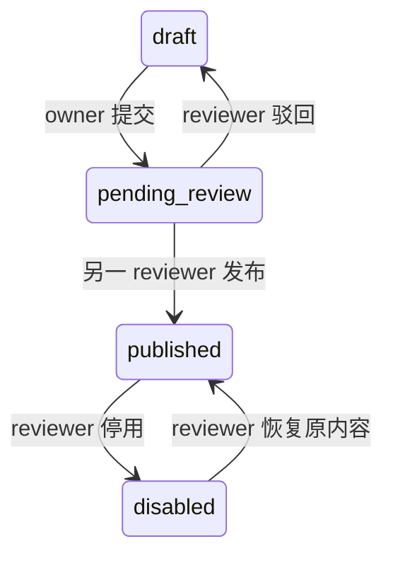

# T4 · 应用注册与发布

注册控制面保存应用所有者、不可变发布组合、独立租户启用关系和操作审计。管理 API 已接入现有 OIDC / BFF；数据库执行迁移 4 后可用。所有部署配置默认为空，不预置应用、管理员或租户授权。

本阶段提供注册与管理接口。[T6 门户](portal.md) 提供授权清单和应用入口，[T8 管理工作区](registry-management.md) 提供注册、审核、租户版本与操作记录；应用代理、运行授权、旧版本排空与流取消已在 [T5 网关](gateway.md) 落实。`available` 是当前发布 / 租户启用状态的派生值，不是下游健康状态，也不代表用户已获得业务权限。

## 发布记录与受控部署

Application 保存稳定 appId、初次注册名称 / 分类与所有者；Release 保存每个版本的完整展示信息和前后端组合。当前版本展示以 Release Manifest 为准。应用 owner 没有公开修改接口。`version` 是发布组合版本，`frontendArtifact.version` 与 `backendVersion` 可独立编号。首次发布后 Manifest、提交者和首次发布时间不可改动；需要变化时创建新发布版本。

正式写入格式见 [Manifest v1](../../contracts/manifests/README.md)。字段类型、未知 / 重复字段、状态及大小由服务端严格校验。入口只能精确为 `/apps/{appId}/{frontendArtifact.version}/`；不接受外部 URL、任意路径或注册方提供的后端地址。

部署者通过受控应用配置提供以下映射；下例是格式示例，摘要不代表已构建资源，目标服务也不会由平台自动启动：

```json
{
  "Registry": {
    "FrontendArtifacts": [
      {
        "AppId": "production-reports",
        "Version": "1.0.0",
        "Entry": "/apps/production-reports/1.0.0/",
        "Sha256": "aaaaaaaaaaaaaaaaaaaaaaaaaaaaaaaaaaaaaaaaaaaaaaaaaaaaaaaaaaaaaaaa"
      }
    ],
    "BackendBindings": [
      {
        "Service": "production-api",
        "Version": "1.0.0",
        "Audience": "assembleai:production-api",
        "Destination": "http://127.0.0.1:8201/"
      }
    ]
  }
}
```

可用配置文件或 `Registry__FrontendArtifacts__0__AppId` 等环境变量提供。重复 app / artifact-version 或 service / backend-version 绑定使启动失败；服务目标仅接受无 userinfo、query、fragment、反斜杠的 HTTP(S) 地址。内部地址可由可信部署者配置，普通注册方不能提供目标。目标和 audience 不包含在管理 API 响应中。

保存草稿不要求部署已完成；发布及恢复启用必须匹配前端入口 / SHA-256 和后端版本声明。配置在启动时读取，不热更新。部署方应保持已发布版本的映射不变；更换内容须建立新版本。T4 不发网络探测，也不下载发布物来计算摘要；T5 创建运行时会检查后端健康及版本协议；完整资源存在性、前端构建兼容与自动服务发现接入仍按 T7 / T14 验收。全局禁用仍可在部署映射缺失时执行。

## 权限与状态

| 操作 | 必需权限 / 约束 |
| --- | --- |
| 创建应用、保存草稿、提交审核 | 当前 enabled 平台用户具有全局 developer；已有应用只能由 owner 操作 |
| 查看发布记录 | owner developer 或全局 reviewer |
| 驳回、发布、全局停用、恢复 | 当前全局 reviewer；publish 操作者不得是本次提交者，即使其同时有 developer 角色 |
| 读取 / 修改租户配置 | 服务端会话已选择同一 tenant；当前成员具备 `registry:manage`，资源为 `application/{appId}`，且 tenantWide=true |

全局角色存于 `platform_registry_operators`，与租户角色独立；审核者不会因此获得租户配置或制造数据权限。每次操作重新查数据库，无授权缓存；已取得快照的在途操作沿用 T3 的撤权边界。普通租户成员无默认注册管理权。初始化由受信运维针对既有 `(issuer,subject)` 用户分配全局角色，不能从请求头或 OIDC 显示字段自动提升权限；正式权限管理界面归 T13。



草稿可以编辑；审核期间禁止修改。恢复只恢复已经审核过的相同内容，不重新创建发布组合。第一次发布时写入 publishedAt，后续停用 / 恢复不改它。

租户独立保存 `{releaseVersion,enabled,revision}`。新建、切换和启用只接受全局 published 版本。全局停用后仍可将当前租户关系停用，但不能把指针移到未发布版本。回滚就是选择一个仍为 published 的旧版本。响应 `available = enabled && release.status == published`；全局停用不批量改写租户记录，后续读取即时反映不可用。

## HTTP 契约

全局基础路径：`/api/platform/v1/registry/apps/{appId}/releases`。

| 方法 / 后缀 | 请求 / 响应 |
| --- | --- |
| GET 空后缀 | `{items:[release...]}`；按版本字符串 C 顺序返回完整列表，最多 100 条，超限 503；不是语义版本排序；已知版本可单独读取 |
| GET `/{version}` | `{manifest,revision,ownerUserId,submittedBy,publishedAt}` |
| PUT `/{version}` | `{expectedRevision,manifest}`；manifest.appId / version 与路径完全一致 |
| POST `/{version}/transitions` | `{expectedRevision,action}`；action 为 submit / reject / publish / disable / enable |

租户路径：`/api/platform/v1/tenants/{tenantId}/applications/{appId}`。

| 方法 | 请求 / 响应 |
| --- | --- |
| GET | `{tenantId,appId,releaseVersion,enabled,available,revision,manifest}`；尚未配置时 404 |
| PUT | `{expectedRevision,releaseVersion,enabled}`；返回更新后的配置 |

写操作需 BFF Cookie、固定 `Origin` 和从 `GET /bff/csrf` 获得的 `X-CSRF-TOKEN`；租户操作还需先经 `POST /bff/tenant` 选择目标。请求是 application/json，字段集合固定，禁止额外或重复字段。整个正文最大 64 KiB、深度 8，内含 Manifest 最大 32 KiB。

新建时 expectedRevision=0，返回 revision=1；更新要求精确匹配当前 revision，成功递增 1。状态不允许或 revision 不符返回 409，客户端应重新读取后再决定操作。重放同一命令不会重复提交，不能将冲突响应视为成功。后端通过同一 appId 的事务 advisory lock 串行处理发布和租户指针变更，业务变更与审计在同一个 PostgreSQL 事务提交。

所有接口响应 no-store / nosniff，禁止未声明 query。未登录 401；权限、Origin / CSRF 或选中租户不符 403；允许读取但记录不存在 404；非法状态 / 版本冲突 409；请求、Manifest 或部署匹配错误 400；正文过大 413；非 JSON 415；存储故障或容量超限 503。错误只给稳定 code，不返回 SQL、连接串、部署目标或 Token。

T8 补充 3 秒整体预算和活跃 BFF 会话检查：全局接口允许未选租户；租户接口仍要求当前选择一致。读请求返回前再次复核；写请求读取完正文后、进入仓储前再次复核，操作主体来自同次捕获的会话。不宣称会话存储与注册事务具备跨存储原子性。

## 审计及数据库约束

`platform_registry_audit` 保存 eventId、actorUserId、可选 tenantId、appId、releaseVersion、action、result、requestId 与时间；不保存完整 Manifest、Token 或服务目标。进入仓储且有有效平台用户的合法命令会记录成功或权限 / 状态 / 部署拒绝。格式、身份、CSRF、租户选择等 HTTP 边界拒绝发生在命令执行前，不属于该业务审计表；统一边界日志与查询界面归 T13。

审计插入失败时返回安全 503，业务变更完整回滚；此策略对全局发布和租户指针同样生效。审计没有指向可变业务行的外键，以保留历史主体和版本标识。当前没有公开删除 / 导出审计接口，也不宣称可以抵御拥有数据库写权限的运维篡改；留存与备份策略仍归 D9 / T13。

迁移 4 的外键和 CHECK 限定记录关联与合法状态；更新 trigger 强制 revision+1、有效状态转换以及已发布内容不可变。完整 Manifest 语义由服务端校验，数据库不会执行 JSON Schema。所有控制面查询均使用应用数据库角色和参数化值。当前 `apply.sql` 完整执行 1–8，可重复运行；readiness 要求迁移 8，不随 BFF 开关降级。

## 验证

`tools/verify.ps1 -Scope Core` 包含 Manifest 负例和匿名访问边界。`tools/verify-postgres.py` 创建隔离原生数据库，执行迁移及重放，再以实际 OIDC 协议登录和 HTTP API 验证注册、独立审核、发布 / 停用、租户选择、权限撤销、并发切换、回滚、数据库不可变约束及审计故障回滚。

OIDC 协议服务是测试 fixture，注册测试使用开发内存会话；数据库注册 / 授权数据真实持久化。T3 的真实 Keycloak 浏览器和 PG 加密会话另有验收，本结果不代替生产完整部署。测试完成后停止自己的数据库并清理临时凭据；不需要 Docker。
